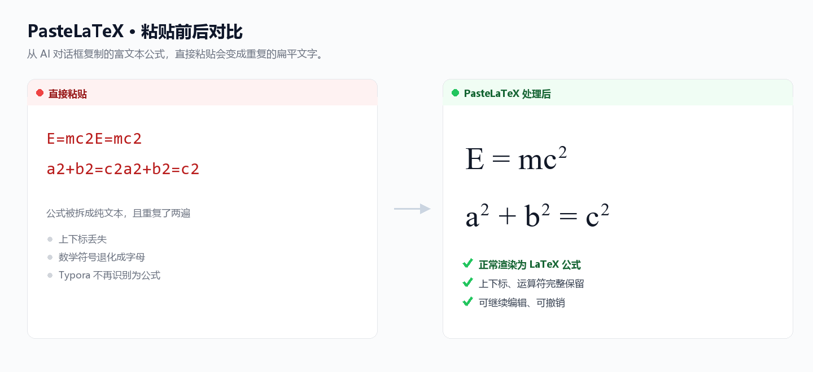

# PasteLaTeX

Paste math from AI chats into Typora. Converts KaTeX MathML (which usually has no TeX annotation) back into LaTeX on paste, keeping lists, formatting and undo intact.

[](https://github.com/BianJi777/PasteLaTeX/releases)
[](https://github.com/BianJi777/PasteLaTeX/actions/workflows/test.yml)
[](LICENSE)



## Why

When you copy a rendered answer from DeepSeek or ChatGPT, the formula markup looks like this:

```html
<span class="katex">
  <span class="katex-mathml"><math><semantics><mrow>…</mrow></semantics></math></span>
  <span class="katex-html">…visual layout…</span>
</span>
```

There is **no `<annotation encoding="application/x-tex">`**, so the original TeX source is gone.
Pasting it into Typora yields duplicated, flattened text such as `C2n=n(n−1)2Cn2=2n(n−1)`.

PasteLaTeX intercepts the paste, rebuilds TeX from the MathML, and hands the result to Typora's own
`editor.UserOp.pasteHandler`, so lists, bold text and the undo stack keep working.

## Install

Requires Typora and [typora-community-plugin](https://github.com/typora-community-plugin/typora-community-plugin).

```powershell
git clone https://github.com/BianJi777/PasteLaTeX.git
cd PasteLaTeX
node pastelatex/build-plugin.mjs
powershell -NoProfile -ExecutionPolicy Bypass -File pastelatex/install.ps1
```

Restart Typora. Copy an answer containing formulas and paste it — done.

Or grab `PasteLaTeX-0.3.0.zip` from [Releases](https://github.com/BianJi777/PasteLaTeX/releases) and unpack it to
`%APPDATA%\Typora\plugins\plugins\pastelatex\`, then add `"pastelatex": true` to
`%APPDATA%\Typora\plugins\settings\plugins.json`.

## Supported

| Category | Status |
|---|---|
| Superscripts, subscripts, fractions, roots | ✅ |
| Greek letters, operators | ✅ |
| Sums, products, integrals, limits | ✅ |
| Control-word boundary (`\sum TD`) | ✅ |
| Matrices, cases, aligned | ✅ |
| Accents, vectors, under/overbrace | ✅ |
| Sets, logic, binomials | ✅ |
| Text, angles, geometry symbols | ✅ |
| Nested formulas | ✅ |
| `\ce{}` (chemistry) | ⚠️ degrades to plain text |
| `\color`, `\cancel` | ⚠️ styling lost at the source |

## Repo layout

    pastelatex/        Typora plugin (v0.3.0)
    m2t/               pure MathML -> TeX converter + fixtures + tests
    docs/              images

## Development

```bash
npm test     # converter fixtures
npm run build
```

## License

MIT
