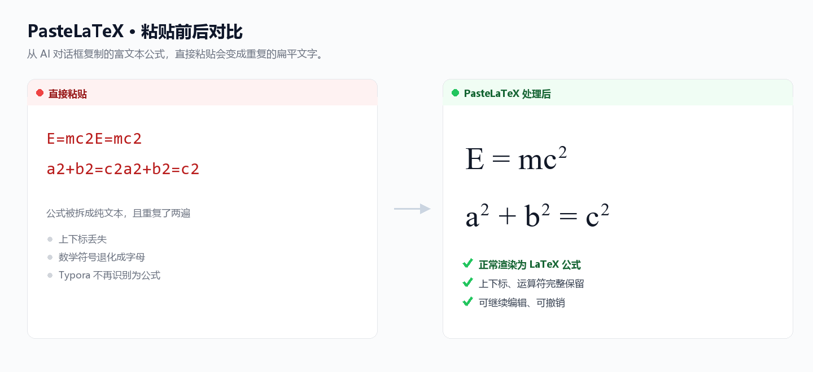

# PasteLaTeX

把 AI 聊天框里的公式直接粘进 Typora：自动将 KaTeX MathML 还原成 LaTeX，保留列表格式与撤销栈。

[](https://github.com/BianJi777/PasteLaTeX/releases)
[](LICENSE)
[](https://github.com/BianJi777/PasteLaTeX/actions/workflows/test.yml)

[English](README.en.md)



## 快速开始

需要 Typora + [typora-community-plugin](https://github.com/typora-community-plugin/typora-community-plugin)。

```powershell
git clone https://github.com/BianJi777/PasteLaTeX.git
cd PasteLaTeX
node pastelatex/build-plugin.mjs
powershell -NoProfile -ExecutionPolicy Bypass -File pastelatex/install.ps1
```

重启 Typora，从 AI 对话框复制带公式的回答，直接粘贴即可。

**不想 clone？** 到 [Releases](https://github.com/BianJi777/PasteLaTeX/releases) 下载 `PasteLaTeX-0.5.0.zip`，解压到
`%APPDATA%\Typora\plugins\plugins\pastelatex\`，并在 `%APPDATA%\Typora\plugins\settings\plugins.json` 中加入 `"pastelatex": true`。

## 已验证平台

以下产品的**网页端**复制 → 粘贴进 Typora 已实测通过：

| 平台 | 状态 | 备注 |
|---|---|---|
| DeepSeek | ✅ | 行内公式、表格 |
| ChatGPT | ✅ | 表格中的公式、\(...\) 定界符 |
| Gemini | ✅ | 行内 / 块级公式 |
| 豆包 | ✅ | 行内公式 |

> 如果你在其他平台遇到问题，欢迎提 Issue，附上原始公式和期望效果。

## 解决什么问题

DeepSeek / ChatGPT 网页端复制出来的公式，HTML 里是这样的：

```html
<span class="katex">
  <span class="katex-mathml"><math><semantics><mrow>…</mrow></semantics></math></span>
  <span class="katex-html">…视觉排版…</span>
</span>
```

**没有 `<annotation encoding="application/x-tex">`**，拿不到原始公式源码（TeX / LaTeX 数学语法）。
直接粘进 Typora 会变成重复的扁平文字：

    C2n=n(n−1)2Cn2=2n(n−1)

PasteLaTeX 在粘贴时把每个 `.katex` 节点还原成 TeX，再交给 Typora 自己的
`editor.UserOp.pasteHandler`，所以列表、加粗、撤销栈都保持原样。

## 仓库结构

    pastelatex/        Typora 插件（v0.5.0）
      glue-plugin.js    粘贴拦截 + 节点替换
      build-plugin.mjs  构建：把转换器内联进 dist/main.js
      manifest.json     插件清单
      install.ps1       安装
      uninstall.ps1     卸载
    m2t/
      mathml2tex.mjs    纯函数 MathML → TeX 转换器（与宿主无关）

## 能力矩阵

| 类别 | 状态 |
|---|---|
| 上下标、分数、根式 | ✅ |
| 希腊字母、运算符 | ✅ |
| 求和 / 求积 / 积分 / 极限 | ✅ |
| 控制词边界（`\sum TD`） | ✅ |
| 矩阵、分段函数、多行对齐 | ✅ |
| 重音、向量、上下括号 | ✅ |
| 集合、逻辑、组合数 | ✅ |
| 文本、角度、几何符号 | ✅ |
| 嵌套公式 | ✅ |
| AI 对话表格中的公式 | ✅ |
| `\(...\)` / `\[...\]` 定界符 | ✅ |
| 裸 `\frac{}{}`、`\sqrt{}` | ✅ |
| 化学式 `\ce{}` | ⚠️ 降级为纯文本 |
| `\color` / `\cancel` | ⚠️ 样式丢失（源头无信息） |

## 安装（详细）

1. 安装 [typora-community-plugin](https://github.com/typora-community-plugin/typora-community-plugin)；
2. 构建并安装：

   ```powershell
   node pastelatex/build-plugin.mjs
   powershell -NoProfile -ExecutionPolicy Bypass -File pastelatex/install.ps1
   ```

3. 重启 Typora。

安装脚本会写入：

    %APPDATA%\Typora\plugins\plugins\pastelatex\
    %APPDATA%\Typora\plugins\settings\plugins.json

## 设置

首次启动会在插件目录生成 `settings.json`：

    %APPDATA%\Typora\plugins\plugins\pastelatex\settings.json

```json
{
  "convertKatex": true,
  "convertDelims": true,
  "wrapBare": true,
  "debug": false
}
```

| 键 | 作用 |
|---|---|
| `convertKatex` | 转换 KaTeX 节点 / `data-math-source` |
| `convertDelims` | 转换 `\(...\)` 与 `\[...\]` |
| `wrapBare` | 转换裸 `\frac{}{}`、`\sqrt{}`、`\binom{}{}` |
| `debug` | 写调试日志到 `~/.typora/paste-math.log` |

改完重启 Typora 生效。

## 卸载

```powershell
powershell -NoProfile -ExecutionPolicy Bypass -File pastelatex/uninstall.ps1
```

## 已知限制

- `\color`、`\cancel`、`\ce` 的信息在 KaTeX 生成的 MathML 里就不存在，无法还原。
- 依赖 Typora 的 MathJax 渲染，块级公式统一输出为 `$$\n…\n$$`。

## 更新日志

### v0.5.0
- 新增 `settings.json` 开关（KaTeX / 定界符 / 裸命令 / 日志）
- 转换失败时弹出通知，不再静默
- 修复行内代码里的 `\(...\)` 被误转换

### v0.4.0
- 支持 `<table>` 中的公式：保留表格结构，只替换单元格里的数学
- 优先使用 `data-math-source`（精确源码），没有时再走 MathML
- 支持 `\(...\)` / `\[...\]` 定界符
- 支持裸 `\frac{}{}`、`\sqrt{}`、`\binom{}{}`（保守白名单）

### v0.3.0
- 插件 id 统一为 `pastelatex`

## 术语

- **TeX**：Knuth 的排版引擎，公式语法（`\frac`、`\sum`）属于 TeX 数学模式。
- **LaTeX**：建在 TeX 之上的宏包，多了 `\documentclass`、`\begin{document}` 这类文档结构。
- 本项目还原的是**公式源码**，不是一份 LaTeX 文档，所以文中用「TeX / LaTeX 数学语法」并称。

## License

MIT
